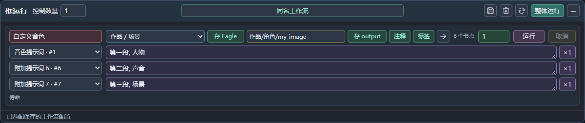

# 框运行 · ComfyUI Group Runner 1.3.0

把 Ctrl + G 创建的分组放进一个可拖动浮窗，按行管理提示词、运行次数和取消。它是独立插件，无需改动 EagleAssets 或 OllamaStudio。

1.3.0 增加多提示词批量运行。双击浮窗中的紫色提示词框（或点击右侧 ×数量），可在弹窗设置文本框数量或逐个添加，填写不同风格的完整提示词。主浮窗只显示第一条非空提示词及已填写数量，空白框不计数；点击 ×、弹窗外侧或 Esc 关闭，编辑即时保留。对应的「框运行 · 通用文本」节点保留第一条，并增加其余提示词的小文本框。批量列表与排除的空白框随工作流绑定保存，节点文本列表也随工作流文件保存。

例如填入北欧、中古、现代、法式、侘寂 5 条，绿色次数设为 1，点击运行依次执行 5 次；次数为 2，则每条执行 2 次，共 10 次。多文本节点按相同序号配对，只有一条的节点重复使用，较短列表沿用最后一条，不做笛卡尔组合。Eagle 注释与标签使用当前这一轮的提示词。

运行中提示词保持可编辑，可以修改后续内容或追加新的风格。已经开始提交的任务使用当时的提示词快照；后续尚未提交的任务读取最新列表。减少列表不会撤销已提交的任务；取消、最小化暂停与切换工作流仍按原有规则执行。批量请使用浮窗的运行按钮；普通 ComfyUI 队列中，通用文本节点仍输出第一条 STRING。



## 安装

1. 解压 `ComfyUI-GroupRunner.zip`，将同名文件夹放到实际 ComfyUI 的 `custom_nodes` 下。
2. 正确路径为 `ComfyUI/custom_nodes/ComfyUI-GroupRunner/__init__.py`。
3. 重启 ComfyUI，浏览器按 **Ctrl + F5**。浮窗会自动出现；若上次最小化，点击左下角「框运行」。

使用 ComfyUI 已有的 Python 和 aiohttp，无需下载模型或安装额外依赖。请保持 ComfyUI 前端扩展已启用。

## 使用

1. 在画布中选中节点，按 **Ctrl + G** 创建分组并命名。
2. 浮窗第一行的「控制数量」默认 1，可设 1–64 行。仅选择需要单独运行的框，用途标记框不用添加。
3. **双击**每行左侧红色区域，在弹窗里选择当前工作流的分组；可搜索名称，按 Enter 也可打开选择器。点击弹窗外或 × 关闭。
4. 要在浮窗编辑提示词，在对应分组中添加 **「框运行 · 通用文本」** 节点，将其 `text` 输出连接模型的 STRING 提示词接口。提示词位于分组与运行控制的下一行，**每个文本节点各占一行**，分别编辑、保存并写入执行请求。只有一个文本节点时直接显示名称；多个时每行显示下拉框，选择其他节点会交换两行的位置，各节点的内容跟随名称保留。编辑会立即更新画布节点；添加或移除配套文本节点后，浮窗自动更新对应行。
5. 绿色数字是本行**每条提示词的执行次数**，范围 1–1000。点击「运行」只运行这一行；只有一条提示词时，10 表示提交 10 次该分组执行，多条时总次数为提示词条数 × 绿色次数，并非改变模型节点里的图片批量大小。
6. 「整体运行」按行从上到下执行，每行完成全部提示词及各自次数后再处理下一行。例如两行都只有一条提示词，第一行 2 次、第二行 3 次，共执行 5 次。每次完成后才提交下一次，不会一次性塞满大量任务。
7. 「取消」只停止本行后续批次，删除本行已排队的任务；如果本行任务正在运行，则请求中断该任务。不会清空其他任务，也不会中断其他行或其他客户端的任务。中断要等当前计算节点响应。

## Eagle 导出联动

分组名称与下方文本节点名称等宽，超长名称以省略号隐藏。其右侧的六项控制按以下顺序排列，窄窗口下会换行：

| 控制 | 作用 |
| --- | --- |
| Eagle 目录 | 下拉选择当前 Eagle 素材库的文件夹，也可选择素材库根目录 |
| 存 Eagle | 开启后保存到 Eagle，亮起表示开启，灰色表示关闭 |
| output 路径 / 文件名前缀 | 对应导出节点的 `filename_prefix`，例如 `作品/角色/my_image`，位于 ComfyUI 的 output 目录内 |
| 存 output | 独立控制是否保存到 output，亮起表示开启 |
| 注释 | 开启后，将本行全部提示词按显示顺序合并到 Eagle 注释 |
| 标签 | 开启后，将本行全部提示词合并，按中英文逗号、分号或换行拆分标签，去除重复项 |

「标签」后面的 **→ 跳转箭头**可将该行对应的分组快速居中到画布，保持当前缩放比例。分组移动后仍按最新位置定位；运行过程中也可点击查看该组。此按钮不依赖 Eagle 导出节点，未选择分组或分组已删除时置灰。

支持 **ComfyUI-EagleAssets 的图片、视频、音频和 3D 模型导出节点**。同一分组有多个导出节点时统一应用这些设置，各节点的 Eagle 地址、Token 及其他格式参数保留。目录读取使用导出节点的连接；同组节点需要使用相同的 Eagle 地址及 Token。连接地址或素材库更换后，点击导航栏刷新并重新选择目标目录。

首次选择分组时，从第一个 Eagle 导出节点读取保存开关、目录及文件名前缀。控制变化会同步到画布节点，点击运行时再次应用本行保存的设置。六项控制随工作流绑定一起保存；没有 Eagle 导出节点时显示灰色不可用，其他分组运行功能仍可正常使用。无需更新 EagleAssets 插件代码。

注释按以下格式合并：

```text
第一个文本框的实际内容

第二文本框内容
第二个文本框的实际内容

第三文本框内容
第三个文本框的实际内容
```

注释或标签开启时，本次框运行请求优先使用合并内容；画布原有的 `annotation` / `tags` 连线保留。关闭后沿用导出节点原有的手动内容或连线，不自动附加提示词。保存到 Eagle 关闭时不会写入 Eagle 素材库；两个保存开关均关闭时，EagleAssets 仍按原有行为生成临时预览。

运行时按 ComfyUI 的依赖关系保留必要上游，排除无关输出分支。**如果组内节点依赖框外节点，必要的框外上游仍可能执行**。仅有文本、采样器等非输出节点的分组，也可借助插件自动添加的临时执行终点运行；这个终点仅存在于本次 API 请求中，不往画布增加节点。搜索中的「框运行 · 执行终点（内部）」不需要手动使用。

种子会调用原节点的 `beforeQueued` / `afterQueued` 机制：原节点设为随机时可逐次变化，固定种子仍固定。相同输入也遵守 ComfyUI 正常缓存规则；次数表示执行请求次数，不承诺每次一定重新加载模型或产生不同图片。

## 工作流绑定与保存

- 导航栏中央显示当前工作流名，点击可隐藏 / 显示；识别依据优先使用工作流完整路径，同名但不同目录的工作流分开保存。保存（软盘）、删除（垃圾桶）、刷新（循环箭头）、整体运行与最小化统一靠右，图标悬停会显示说明。
- **只有点击「保存」才写入绑定配置**。控制数量、分组、文本节点、提示词和次数一起保存，切换回该工作流会自动匹配。尚未保存的修改在当前页面的工作流草稿中保留，刷新浏览器后不作为已保存配置恢复。
- 配置保存在 ComfyUI 用户目录的 `group_runner/bindings.json`。自定义 `--user-directory` 时跟随该目录。
- 保存时也向工作流 `extra.group_runner_binding` 写入标识；再使用 ComfyUI 自身的保存功能，可将标识带进工作流文件，方便改名或再次打开。没有路径信息的前端依次以工作流 UUID、节点结构标识匹配。
- 工作流复制或另存为新路径时，可读取文件携带的配置作为草稿；点击保存会建立新绑定，避免覆盖原工作流的设置。
- 「删除」只删除当前工作流的绑定，不删除工作流、节点或分组；当前页面的编辑仍可继续使用。
- 「刷新」重新读取保存记录并扫描当前工作流，保留当前未保存的编辑。
- 1.0.0 的单文本配置和 1.1.0 的多文本配置可直接读取，原有提示词会保留；点击保存后写入支持 Eagle 控制的新版配置。

控件采用紧凑高度，减少文字上下空白。提示词框从一行高度开始，随内容自动增高，最多显示六行；长文本可滚动查看，也可拖动右下角手动调整高度。窄窗口中导航栏自动换行，工作流名称仍居中。

## 最小化与暂停

拖动标题栏空白位置可移动浮窗。「−」将其缩为「框运行」小按钮，首次出现在左下角；**按住小按钮可自由拖动**，位置会在当前浏览器中记住，窗口变化时保持在可见范围。拖动松手不会误触恢复，单击可恢复浮窗。最小化暂停后续提交及工作流扫描，已经提交的一次任务可以继续完成；恢复后需要点击本行「继续」或「继续全部」才能继续剩余次数。

切换工作流时同样暂停旧工作流的后续批次，不会把旧行的任务提交到新工作流。新工作流可以独立设置和运行。返回旧工作流后，可手动继续或取消它的剩余批次。

运行进度属于当前浏览器页面，**不在重载页面后自动重放未完成批次**；已经进入 ComfyUI 队列的任务仍由原生队列管理。绑定配置独立持久保存。

## 示例与验证

导入 `examples/text-groups-workflow.json` 可得到两个通用文本分组，无需模型即可验证分组选择和文本控制；正式生成时再连接实际模型工作流。

已验证：四类 Eagle 导出请求的六项控制、真实 EagleAssets ExportEditor 前端同步、目录下拉、注释及标签合并与关闭后的连线恢复、工作流绑定恢复、分组名称宽度对齐，以及最小化按钮拖动与位置记忆。同时覆盖多个提示词独立编辑及执行、旧配置迁移、文本节点添加 / 移除、375–1500 像素窗口排版、目标取消隔离、依赖过滤、临时输出终点、种子回调、两行 2+3 次顺序执行及工作流切换竞态。测试使用真实插件 HTTP 路由、EagleAssets 前端与模拟 ComfyUI / Eagle 服务，没有运行真实模型或向实际 Eagle 素材库写入文件；具体第三方节点的特殊排队回调仍需在实际 ComfyUI 环境中核对。

接口依据：[ComfyUI 前端排队 API](https://github.com/Comfy-Org/ComfyUI_frontend/blob/main/src/scripts/api.ts)、[执行序列化及种子回调](https://github.com/Comfy-Org/ComfyUI_frontend/blob/main/src/scripts/app.ts)、[分组成员读取](https://github.com/Comfy-Org/ComfyUI_frontend/blob/main/src/extensions/core/groupOptions.ts)、[画布居中方法](https://github.com/Comfy-Org/ComfyUI_frontend/blob/main/src/lib/litegraph/src/LGraphCanvas.ts)、[类型兼容验证](https://github.com/Comfy-Org/ComfyUI/blob/master/comfy_execution/validation.py)。
